# GRH in "The Music of the Primes" — the dependency map

`grh.b4m` formalizes the GRH deduction the manuscript outlines in §1.4, with every step
kernel-checked. This file is the index to it.

## The current frontier, exactly

**`2b4m check examples/music-of-primes` PASSES.** There are no bare holes left: every
result the chain rests on is either kernel-checked here or cited with a prefix saying who
owes it. `--axioms` on `generalizedRiemannHypothesis` reports **40 entries**.

### The full accounting

| | n | means | who owes it |
|---|---|---|---|
| `cites "gap: …"` | 5 | absent from the released draft | **the author** |
| `cites "assertion: …"` | 13 | he states it, does not prove it | the author, or a reader |
| `cites "manuscript-proved: …"` | 4 | stated AND proved in the text, not transcribed here | **us**, as future work |
| `cites "standard: …"` | 14 | classical, with a textbook source | nobody — cited and closed |
| DEFINITION clause | 4 | introduces a symbol, not an assumption | — |
| **total `--axioms` entries** | **40** | | 36 cited + 4 definitions |

These are what `generalizedRiemannHypothesis` **transitively rests on**. The `standard/`
files declare more than GRH reaches (19 `standard:` and 10 `manuscript-proved:` holes exist
across the corpus), because each classical fact is kept load-bearing for a local theorem in
its own file — an uncited hole is invisible to `--axioms`, so leaving one dangling would hide
it. Quote the GRH-transitive numbers when asking "what does the claim rest on"; the corpus
totals answer a different question.

The four prefixes answer different questions about the author's text — *absent* /
*claimed* / *proved-but-untranscribed* / *classical*:

    grep -rn 'cites "gap:' .                 # the list to send the author
    grep -rn 'cites "assertion:' .           # candidates a reader could close
    grep -rn 'cites "manuscript-proved:' .   # OUR transcription backlog

`manuscript-proved:` is the one that is work for us rather than for him. Each names a
theorem the released text states and proves; transcribing one changes nothing downstream,
because the interface its consumers depend on is already fixed.

## How to read the holes

`hole` here is a **workspace tool**, not a verdict on the manuscript. It marks "work to do,"
and the prefix says whose:

| kind | means | strict `check` |
|---|---|---|
| **bare `hole X`** | ours to transcribe, not yet attempted | **FAILS** — stays on the worklist |
| **`hole X cites "<prefix>: …"`** | assumed; the prefix records why and who owes it | passes, disclosed |

There are currently **no bare holes**. A bare hole is how a new piece of work enters: write
it bare, and strict `check` keeps it on the worklist until it is proved or cited.

    2b4m check examples/music-of-primes                     # passes
    2b4m check --axioms examples/music-of-primes/grh.b4m generalizedRiemannHypothesis

## What is kernel-checked

Four of the manuscript's results were bare holes until their proofs were read and recorded
as the chains they are. Each assembly below is verified by the kernel; only its analytic
inputs are cited.

| result | file | shape of the proof |
|---|---|---|
| Thm 12.5.1.1 (Trace Formula) | `trace-formula/trace-formula.b4m` | choose S, stratify, partition, regroup, cancel, identify two sides |
| Thm 11.3.2.1 (Orbital Traces) | `standard/orbital-traces.b4m` | vanishing → indicator → convergence → nuclearity → finite-rank limit → zero side → Poisson |
| Thm 12.4.1.1 (S-local Trace) | `standard/s-local-trace.b4m` | descend → nuclearity → reduce to E → lift phi → compute → collect per-place |
| Def 10.4.3.7 (kernel algebra) | `standard/spectral-kernel.b4m` | definition block; the rearrangement is PROVED, not assumed |

### Two things the decomposition surfaced

**Def 10.4.3.7's algebra was hiding inside an opaque hole.** The manuscript says (12.5.1.4)
holds "by **design** of the global geometric kernel (see Definition 10.4.3.7) and by Theorem
10.4.2.8" (txt 31569) — so one half is a DEFINITION, not analysis. Written as a definition
block, `k_spec = phi − k_geom` is now kernel-checked from one cited group law. A bundled hole
hiding a definition inside it is exactly the thing worth splitting.

**12.4.1.1's proof carries the author's own unfinished notes.** Footnote 1: *"Include
section."* Footnote 2: *"Extend Definition 9.3.3.1 so as to allow cutoffs whose support is
over (0, λ] and not only over [1/λ, λ]. Return here and change the choice of smooth
(λ, ε)-cutoff into a smoothening of 1_[1/λ'', λ] with λ'' not tied to λ. Then study the
convergence of the integral in (12.4.1.23) … as λ', λ'' → +∞."* So the cutoff definition
this proof needs is, by his own note, **not yet the one he has**, and a convergence study is
outstanding — inside a proof the Trace Formula depends on. That is the fifth `gap:`.

### Where the deepening stops

The analytic cores stay cited, and that is deliberate. What is recorded is the SHAPE of each
proof and the SPECIFIC result each step invokes; what is not recorded is the estimate work
inside those results. Splitting further would mint opaque predicates named after proof steps,
which checks nothing and makes the artifact look deeper than it is.

The honest statement: the STRUCTURE of the derivation from Trace Formula to GRH is
machine-checked end to end. The ANALYSIS underneath it is cited, and closing it needs the
measure theory and functional analysis [`WHAT-IT-WOULD-TAKE.md`](WHAT-IT-WOULD-TAKE.md)
measures.

### The `assertion:` tier — where the author asserts rather than proves

Each quotes his own words, so a reader can check the attribution. Vakil's announcement
invites readers to fill small gaps, so these are candidates to close rather than permanent
assumptions.

| hole | the author's words |
|---|---|
| `finitelyManyEnlargementsSuffice` | "We further assume S is large enough so as to arrange…" |
| `theStrataAreBuiltFromInitialSegments` | "…where we **assume**: (1) S is saturated…" |
| `segmentNestingLiftsToTheStrata` | stated as the construction, not argued |
| `theConstructionSatisfiesTheStandingHypotheses` | "**For example**, take ε > 0 small…" |
| `holomorphyCoversTheWholeRightRegion` | "This implies that L_f(s,χ)… has no zeros over C_{>1/2}" |
| `theStrataIndexSplitsAtS` | "By (11.3.1.4), this reads:" — the index-splits half |
| `theRegroupedSumIsTheKernelSplit` | the same sentence's other half |
| `theIndentedKernelVanishesOffTheStratum` | "We observe that k_geom^Δ … vanishes unless…" |
| `theStratumIndicatorPreservesTheValue` | "for a suitable large enough integer k_0 ≥ 0" |
| `phiDescendsAndMayBeTakenHomogeneous` | "We assume, without loss of generality, that φ is χ-homogeneous" |
| `theTruncatedConvolutionIsNuclear` | "we obtain a nuclear operator. We compute its trace below" |
| `theOffSEulerContributionVanishes` | "each ∫k_p(x,x) dμ(x) = 0 for all prime numbers p that are not…" |
| others | `admissibilityIsSLocalAdmissibility`, `theLocalIntegralSumIsTheGeometricSide`, `theGlobalIntegralIsTheSpectralKernelValue` — granularity bridges between layers |

### Glue holes — the failure mode to watch for

A hole whose statement is `P(x) -> Q(x)` with both sides opaque is almost always **glue**: it
moves an assumption without checking anything, while making the artifact look deeper. The fix
is to DEFINE one predicate in terms of the other, so the step becomes a definition unfold the
kernel verifies. Three were caught and removed this way; `partitionsTheDomain` in
`standard/analysis.b4m` and the kernel algebra in `standard/spectral-kernel.b4m` are the
surviving examples of the fix.

### The classical tier (`standard:`)

| cited | source |
|---|---|
| Lebesgue differentiation (loc. cpt. abelian) | Federer §2.9; Hewitt-Ross I §44 |
| Hardy-Littlewood maximal | Stein-Weiss Ch. II |
| Poisson summation (jump singularities) | Tate's thesis §4; Weil BNT §VII; Iwaniec-Kowalski §4.3 |
| non-vanishing of L(s,χ) on Re(s)=1 | Hadamard-de la Vallée Poussin; Iwaniec-Kowalski Thm 5.10 |
| countable additivity of a Haar integral | Halmos §25; Hewitt-Ross I §15 |
| regrouping an absolutely convergent sum over a partition | Rudin PMA Thm 3.55, §8; Halmos §25 |
| a sum of vanishing terms vanishes | Rudin PMA Thm 3.1 |
| the trace is continuous on the trace class | Reed-Simon I Thm VI.26; Simon, Trace Ideals §1-3; Conway, Operator Theory Ch.3 §18 |
| bump functions + mollifier convergence | Hörmander I §1.2-1.4; Rudin FA Thm 6.20 |
| ideal class group finiteness ⇒ Pic(O_{F,S})=1 | Neukirch I §6, §12 |
| finitely many Archimedean/ramified places | Neukirch I §8, III §2 |
| a zero of L forces a pole of L'/L | Ahlfors Ch. 4 §3; Conway VIII §1 |
| only finitely many primes below a norm bound | Neukirch I §6 Prop 6.1; Lang V §1 |
| compact support meets finitely many places | Weil BNT IV §1; Tate's thesis §3.1 |
| x + 0 = x, and a − (a − b) = b | (opaque `Quantity`, so its group laws are stated) |

**A round that reclassifies rather than reduces is still progress.** Splitting a bundled hole
often trades one opaque assumption for several sharper ones plus a classical citation —
the entry count went from 29 to 40 while the bare count went from 3 to 0. `rests on
class-group finiteness — Neukirch I §6` is auditable where `rests on theOrbitalTracesVanishOffS`
was not.

## The chain

A DAG. Legend: plain = kernel-checked here, *italic* = cited (the prefix says which tier).
No node is a bare hole any more.

```mermaid
graph TD
  GRH["generalizedRiemannHypothesis<br/>(kernel-checked)"]

  subgraph grh["grh.b4m — the §1.4 deduction"]
    CONSTR["<i>theConstructionSatisfies…</i><br/>ASSERTION: §1.4.2"]
    LIMIT["<i>theLimitInterchangeIsValid</i><br/>GAP: §1.4.3-4, the hard step"]
    POLE["<i>theLogDerivativeHasOnlyTheCentralPole</i><br/>GAP: §1.4.5, stale §5.1 ref"]
    RIGHT["<i>holomorphyCoversTheWholeRightRegion</i><br/>ASSERTION: region bookkeeping"]
    REFL["<i>theFunctionalEquationReflects…</i><br/>GAP: §1.4.5, one line"]
    EXCL["<i>everyZeroOffTheLineIsExcluded</i><br/>GAP: IS Thm 13.3.1.2"]
  end

  subgraph tf["trace-formula/ — Thm 12.5.1.1, PROVED"]
    TF["theTraceFormula<br/>(kernel-checked)"]
    ORB["theOrbitalTracesVanishOffS<br/>(kernel-checked)"]
    SLOC["theSLocalTraceCalculation<br/>(kernel-checked)"]
    SPECSIDE["theSpectralSideIsTheKernelIntegral<br/>(kernel-checked)"]
    ENL["<i>finitelyManyEnlargementsSuffice</i><br/>ASSERTION"]
    SEGS["<i>theStrataAreBuiltFromInitialSegments</i><br/>ASSERTION"]
    ISPLIT["<i>theStrataIndexSplitsAtS</i><br/>ASSERTION"]
    RSPLIT["<i>theRegroupedSumIsTheKernelSplit</i><br/>ASSERTION"]
  end

  subgraph orb["standard/orbital-traces.b4m — Thm 11.3.2.1, PROVED"]
    ORBTHM["theOrbitalTraceIsTheEulerContribution<br/>(kernel-checked)"]
    OCONV["<i>theTruncationsConverge</i><br/>MS-PROVED: Thm 11.1.2.1"]
    ONUC["<i>theConvergedValueIsANuclearTrace</i><br/>MS-PROVED: Prop 12.2.2.2"]
    OFR["<i>theOperatorIsANuclearLimit…</i><br/>MS-PROVED: Thms 10.3.2.1, 11.2.2.1"]
    OZERO["<i>theLimitValueIsTheZeroSide</i><br/>MS-PROVED: Thm 7.4.2.1"]
    OPOIS["<i>poissonSummation…</i><br/>STANDARD: Prop B.4.1.2"]
  end

  subgraph sl["standard/s-local-trace.b4m — Thm 12.4.1.1, PROVED"]
    SLTHM["theSLocalTraceIsTheLocalIntegralSum<br/>(kernel-checked)"]
    SLRED["<i>theTraceReducesToTheSubspace</i><br/>MS-PROVED: Lemma C.3.2.2"]
    SLLIFT["<i>anInvariantLiftOfPhiExists</i><br/>MS-PROVED: Lemma 4.2.1.5"]
    SLCOMP["<i>theComputationGives…</i><br/>MS-PROVED: txt 31213-31460"]
    SLCUT["<i>theExtendedCutoffFamilyExists</i><br/>GAP: the author's footnote 2"]
  end

  subgraph sk["standard/spectral-kernel.b4m — Def 10.4.3.7, PROVED"]
    SKTHM["theSpectralKernelIsTheConvolution…<br/>(kernel-checked from the definition)"]
    SKSUB["<i>subtractionUndoesItself</i><br/>STANDARD: group law"]
    SK428["<i>theProjectedTraceIsTheSpectralTrace</i><br/>MS-PROVED: Thm 10.4.2.8"]
  end

  subgraph ot["standard/operator-theory.b4m"]
    OTTRACE["<i>theTraceIsContinuousOnTheTraceClass</i><br/>STANDARD: Reed-Simon VI.26"]
  end

  subgraph std["standard/ — classical"]
    ADD["<i>countable additivity</i><br/>Halmos §25"]
    REGRP["<i>sums regroup</i><br/>Rudin PMA 3.55"]
    CLS["<i>Pic(O_F,S)=1</i><br/>Neukirch I §6"]
  end

  CONSTR --> GRH
  TF --> GRH
  LIMIT --> GRH
  POLE --> GRH
  RIGHT --> GRH
  REFL --> GRH
  EXCL --> GRH

  OCONV --> ORBTHM
  ONUC --> ORBTHM
  OFR --> ORBTHM
  OTTRACE --> ORBTHM
  OZERO --> ORBTHM
  OPOIS --> ORBTHM
  ORBTHM --> ORB

  SLRED --> SLTHM
  SLLIFT --> SLTHM
  SLCUT --> SLTHM
  SLCOMP --> SLTHM
  SLTHM --> SLOC

  SKSUB --> SKTHM
  SKTHM --> SPECSIDE
  SK428 --> SPECSIDE

  CLS --> ENL
  ENL --> TF
  SEGS --> TF
  ADD --> RSPLIT
  ISPLIT --> REGRP
  REGRP --> RSPLIT
  RSPLIT --> TF
  ORB --> TF
  SLOC --> TF
  SPECSIDE --> TF
```

The Trace Formula's own proof (txt 31539-31567) follows the manuscript's skeleton: choose an
admissible S, build the strata from initial segments, show they nest and partition the
domain, invoke countable additivity, split the strata index at S, regroup the sum, kill the
off-S pieces, identify the S-local piece with the geometric side and the global integral with
the spectral side, conclude the two sides agree. `2b4m query outline` prints that skeleton
for any of the four proved theorems.

### Recorded but NOT yet reachable from GRH

Decomposing 11.3.2.1 made **Poisson summation** live — it is now the last step of
`theOrbitalTraceIsTheEulerContribution`. Two `standard/analysis.b4m` citations remain outside
the DAG: **Lebesgue differentiation** (Thm A.5.4.1) and **Hardy-Littlewood maximal**
(Thm A.5.3.7). Both are classical inputs to the estimate work INSIDE the results now cited as
`manuscript-proved:`, so they become live only when one of those is transcribed. Each is kept
load-bearing for a small local theorem in its own file, because an uncited hole is invisible
to `--axioms`.

Also proved in the text and available when the chain needs it: **Theorem B.4.4.7** (Idelic
Explicit Formulas, Appendix B.4, proof written out) — what §13.1 was to recall. Not currently
cited, so it is recorded here rather than declared.

## The author's gaps (5) — `cites "gap: …"`, assumed pending his work

Each is a `cites` string recording what is assumed and why the released text does not supply
it. **This is the list to send the author.** Four are in `grh.b4m`, in the Chapter 13
deduction; the fifth is inside Theorem 12.4.1.1's proof, flagged by the author himself.

1. **`theLimitInterchangeIsValid`** — §1.4.3–1.4.4. Montel's theorem gives uniform
   convergence for the **finitely many Archimedean** integrals. The non-Archimedean sum is
   infinite, and the author names it himself: *"they are the source of all the difficulties:
   their sum approximates L'_f(s+1/2, χ)/L_f(s+1/2, χ)."* That the interchange is valid is
   asserted, not proved. **This is the mathematical heart of the gap.**

2. **`theLogDerivativeHasOnlyTheCentralPole`** — §1.4.5. Asserted, with the justification
   attributed to "§5.1" — but §5.1 is *"The topological vector spaces of adelic θ-functions
   and Idelic Z-functions"*, so the reference is stale and the argument is not located. The
   author's own `Finish!` footnotes (5 and 6) attach to §1.4's Trace Formula statement.

3. **`theFunctionalEquationReflectsTheZeroFreeRegion`** — §1.4.5, a single line: *"so by the
   functional equation the same holds for L(s, χ) over C_{<1/2}."* The functional equation is
   in the manuscript; this deduction from it is not written out. Likely genuinely routine.

4. **`everyZeroOffTheLineIsExcluded`** — **this is Theorem 13.3.1.2**, the result that would
   assert GRH. Its statement in the released draft is the author's footnote
   `Insert statement`, and §13.1/§13.2 are headings with no body (Ch. 13 is pp. 521–522,
   while every other chapter runs 14–197 pages).

5. **`theExtendedCutoffFamilyExists`** — inside **Theorem 12.4.1.1's own proof**, and flagged
   by the author, not by us. His footnote 2 to that proof: *"Extend Definition 9.3.3.1 so as
   to allow cutoffs whose support is over (0, λ] and not only over [1/λ, λ]. Return here and
   change the choice of smooth (λ, ε)-cutoff into a smoothening of 1_[1/λ'', λ] with λ'' not
   tied to λ. Then study the convergence of the integral in (12.4.1.23), with log|w|_{F,S}
   replaced by log max{|w|_{F,S}/λ', 1/λ''}, as λ', λ'' → +∞."* Footnote 1 to the same proof
   reads *"Include section."* So the cutoff definition this proof uses is, by his own note,
   not yet the one it needs, and a convergence study is outstanding — **inside a proof the
   Trace Formula depends on**. This is the most consequential of the five, because unlike the
   Chapter 13 gaps it sits under a result the author presents as complete.

## What Theorem 11.3.2.1 rests on, in the manuscript

Its proof cites eleven results. Three are classical, and are the ones this formalization
captures with real sources:

| cited | what it is |
|---|---|
| Thm A.5.4.1 | Lebesgue Differentiation over a Hausdorff locally compact abelian group |
| Thm A.5.3.7 | Hardy-Littlewood Global Maximal Theorem |
| Prop B.4.1.2 | Poisson Summation Formula (jump singularities) — now LIVE in the DAG |

The other eight are the author's own nuclearity machinery (Thms 7.4.2.1, 10.3.2.1, 11.1.2.1,
11.2.2.1, 12.2.2.2; Defs 9.3.3.1, 12.1.1.1), and five of them are now cited individually as
`manuscript-proved:` rather than bundled into one hole.

## Two documentation issues to raise with the author

Neither is mathematical; both obstruct a reader following the main argument.

- **The positivity contradiction.** §1.4.6 and §1.7.2 state *"Weil's Positivity Criterion is
  **not** used"*, with a reason (positivity needs φ = ψ₁∗ψ₂, and the only such φ with
  φ(C_F^1)=0 is identically zero). But §14.1.2 and p. 32160 say Theorem 13.3.1.2 follows from
  *"the Trace Formula combined with the Positivity Criterion (in its form from **Theorem ??**)"*
  — an unresolved reference. Chapter 14 reads as older text from when positivity was the
  intended route.
- **The stale §5.1 reference** in §1.4.5, above.

Unresolved `??` references total 12; three of them are this Positivity Criterion.

## Altitude

Deliberately coarse. `Zero`, `TestFunction`, `Complex` are opaque sorts; the analytic content
lives in predicates (`theTraceFormulaHoldsAt`, `theNonArchimedeanSumComputesTheLogDerivative`,
…). No measure theory, no complex analysis, no adeles are modelled.

That is the right altitude for the question being asked — *does the cited chain reach GRH,
and what is missing?* — and it keeps every hole's statement readable against the manuscript.
Formalizing the **analysis** is a different and vastly larger undertaking; this file is the
scaffold that says where it would have to go.
