# GRH in "The Music of the Primes" — the dependency map

`grh.b4m` formalizes the GRH deduction the manuscript outlines in §1.4, with every step
kernel-checked. This file is the index to it.

## The current frontier, exactly

`2b4m check --draft --axioms grh.b4m generalizedRiemannHypothesis` reports **23 entries**,
and they are three different kinds — worth separating, because only the first is work we owe:

| kind | n | |
|---|---|---|
| bare `hole` — **ours to transcribe** | **8** | 2 in `grh.b4m`, 6 in `trace-formula/` |
| `hole … cites` — assumed | 13 | 4 the author's gaps + 9 classical (`standard/`) |
| DEFINITION clause | 2 | `theTraceFormulaHoldsAt`, `isAdmissibleFor` |

(8 + 13 + 2 = 23, which is what `--axioms` reports.)

### The classical tier so far

| cited | source |
|---|---|
| Lebesgue differentiation (loc. cpt. abelian) | Federer §2.9; Hewitt-Ross I §44 |
| Hardy-Littlewood maximal | Stein-Weiss Ch. II |
| Poisson summation (jump singularities) | Tate's thesis; Weil BNT §VII |
| non-vanishing of L(s,χ) on Re(s)=1 | Hadamard-de la Vallée Poussin; Iwaniec-Kowalski Thm 5.10 |
| countable additivity of a Haar integral | Halmos §25; Hewitt-Ross I §15 |
| bump functions + mollifier convergence | Hörmander I §1.2-1.4; Rudin FA Thm 6.20 |
| ideal class group finiteness ⇒ Pic(O_{F,S})=1 | Neukirch I §6, §12 |
| finitely many Archimedean/ramified places | Neukirch I §8, III §2 |
| a zero of L forces a pole of L'/L | Ahlfors Ch. 4 §3; Conway VIII §1 |
| only finitely many primes below a norm bound | Neukirch I §6 Prop 6.1; Lang V §1 |
| compact support meets finitely many places | Weil BNT IV §1; Tate's thesis §3.1 |
| x + 0 = x | (additive unit law, `Quantity` being opaque here) |

**The bare count can go UP, and did.** Splitting the kernel decomposition traded one opaque
hole for two sharper ones plus a classical citation (countable additivity, Halmos §25). That
is a better artifact — "the alpha_k strata partition the ideles" is a checkable claim about
the manuscript's filtration, where "the kernel decomposes" was a black box — but it is not a
reduction, and pretending otherwise would be dishonest bookkeeping.

**The bare count does not fall every round, and that is expected.** Two rounds running, the
gain was RECLASSIFICATION: an assumption moved from "ours, opaque" to "classical, cited with
a source a reader can check". `rests on class-group finiteness — Neukirch I §6` is auditable;
`rests on anAdmissibleSetOfPlacesExists` was not. Both are worth as much to an evaluator as
a reduction, and a bundled hole hiding a classical fact inside it is the thing actually worth
fixing.

A definition is not an assumption — it introduces a symbol rather than constraining a
primitive, which is why `--axioms` labels it separately. Count it apart when quoting totals.

## How to read the holes

`hole` here is a **workspace tool**, not a verdict on the manuscript. It marks "work to do,"
and the two kinds split that work by WHO owes it:

| kind | means | strict `check` |
|---|---|---|
| **bare `hole X`** | the manuscript PROVES this; it is OURS to transcribe into 2b4m | **FAILS** — stays on the worklist |
| **`hole X cites "…"`** | a true gap in the released text; assumed pending the author | passes, disclosed |

So a failing `2b4m check` is the normal state, and its output is the transcription backlog.
When every bare hole is discharged, what remains is exactly the list to send the author.

    2b4m check examples/music-of-primes/grh.b4m              # the backlog
    2b4m check --draft --axioms examples/music-of-primes/grh.b4m generalizedRiemannHypothesis

## The chain

A DAG, not a line — it branched once `standard/` and the trace-formula layer appeared.
Legend: **bold** = a bare hole we owe, *italic* = cited (classical or the author's), plain =
kernel-checked.

```mermaid
graph TD
  GRH["generalizedRiemannHypothesis<br/>(kernel-checked)"]

  subgraph grh["grh.b4m — the §1.4 deduction"]
    CONSTR["<b>theConstructionSatisfiesTheStandingHypotheses</b><br/>§1.4.2 lands in D(C_F), φ(C_F¹)=0"]
    LIMIT["<i>theLimitInterchangeIsValid</i><br/>AUTHOR: §1.4.3-4, the hard step"]
    POLE["<i>theLogDerivativeHasOnlyTheCentralPole</i><br/>AUTHOR: §1.4.5, stale §5.1 ref"]
    RIGHT["<b>holomorphyCoversTheWholeRightRegion</b><br/>the region bookkeeping"]
    REFL["<i>theFunctionalEquationReflects…</i><br/>AUTHOR: §1.4.5, one line"]
    EXCL["<i>everyZeroOffTheLineIsExcluded</i><br/>AUTHOR: IS Thm 13.3.1.2"]
  end

  subgraph tf["trace-formula/ — Thm 12.5.1.1, PROVED"]
    TF["theTraceFormula<br/>(kernel-checked)"]
    ENL["<b>aPlaceSetCanBeEnlargedToSuitAnyTestFunction</b>"]
    PART["<b>theDivisorialFiltrationPartitionsTheIdeles</b>"]
    SPLIT["<b>theDivisorialFiltrationSplitsTheIntegral</b>"]
    ORB["<b>theOrbitalTracesVanishOffS</b><br/>Thm 11.3.2.1 — ANALYSIS"]
    SLOC["<b>theSLocalTraceCalculation</b><br/>Thm 12.4.1.1 — ANALYSIS"]
    SPEC["<b>theSpectralSideIsTheKernelIntegral</b><br/>Def 10.4.3.7 + Thm 10.4.2.8 — ANALYSIS"]
    UNIT["<i>addingNothingChangesNothing</i>"]
  end

  subgraph std["standard/ — classical, cited with sources"]
    MOLL["<i>mollifiers + bump functions</i><br/>Hörmander I §1.2-1.4"]
    NONV["<i>non-vanishing on Re(s)=1</i><br/>Hadamard-dlVP"]
    ZPOLE["<i>a zero forces a pole of L'/L</i><br/>Ahlfors Ch.4 §3"]
    ADD["<i>countable additivity of a Haar integral</i><br/>Halmos §25"]
    CLS["<i>Pic(O_F,S)=1 for large S</i><br/>Neukirch I §6,§12"]
    FIN["<i>finitely many ramified places</i><br/>Neukirch I §8"]
  end

  MOLL --> CONSTR
  CONSTR --> GRH
  TF --> GRH
  LIMIT --> GRH
  POLE --> GRH
  ZPOLE --> RIGHT
  NONV --> RIGHT
  RIGHT --> GRH
  REFL --> GRH
  EXCL --> GRH

  CLS --> ENL
  FIN --> ENL
  ENL --> TF
  ADD --> SPLIT
  PART --> SPLIT
  SPLIT --> TF
  ORB --> TF
  SLOC --> TF
  SPEC --> TF
  UNIT --> TF
```

### Recorded but NOT yet reachable from GRH

Three `standard/analysis.b4m` citations sit outside the DAG above:
**Lebesgue differentiation**, **Hardy-Littlewood maximal**, **Poisson summation**. They are
the classical inputs to *Theorem 11.3.2.1*, which is still the single opaque hole `ORB` —
so they are recorded (and checked) but nothing yet depends on them. They become live if
`ORB` is ever decomposed, which needs the foundations
[`WHAT-IT-WOULD-TAKE.md`](WHAT-IT-WOULD-TAKE.md) measures.

An uncited hole is invisible to `--axioms`, so each is kept load-bearing for a small local
theorem in its own file rather than left dangling.

## OURS to transcribe (8) — bare holes, currently failing

**`theTraceFormula` is CLOSED** (2026-11-20): Theorem 12.5.1.1 is now proved in
`trace-formula/trace-formula.b4m` from the manuscript's own skeleton, and `grh.b4m` cites it.
Its six dependencies became the new frontier — which is the deepening move working as
intended: one opaque assumption replaced by six located ones.

In `grh.b4m`:

| hole | manuscript source | status there |
|---|---|---|
| `theMollifiedApproximantsExist` | **§1.4.2** | explicit construction (mollifier ρ_ε, bump h) |
| `theEulerProductsOnTheOneLine` | **Theorems B.7.2.1, B.7.2.4** | stated and proved, Appendix B.7 |

In `trace-formula/trace-formula.b4m` (the Trace Formula's own proof, txt 31539-31567):

| hole | manuscript source | status there |
|---|---|---|
| `anAdmissibleSetOfPlacesExists` | proof ¶1 | by construction; rests on Appendix A (S-units, class group) |
| `theGeometricKernelDecomposition` | **eq (11.3.1.4)** | the kernel splits along the diagonal |
| `theOrbitalTracesVanishOffS` | **Theorem 11.3.2.1**, txt 29947 | proved |
| `theSLocalTraceCalculation` | **Theorem 12.4.1.1**, txt 31123 | proved |
| `theSpectralSideIsTheKernelIntegral` | **Def 10.4.3.7** + **Thm 10.4.2.8**, txt 28655 / 27947 | both proved |
| `theTwoSidesCombine` | proof's last line | assembly only |

Also proved in the text and available when the chain needs it: **Theorem B.4.4.7** (Idelic
Explicit Formulas, Appendix B.4, proof written out) — what §13.1 was to recall. Not currently
cited by `grh.b4m`, and an uncited hole is invisible, so it is recorded here rather than
declared.

## The AUTHOR's gaps (4) — cited holes, assumed pending his work

Each is a `cites` string in `grh.b4m` recording what is assumed and why the released text
does not supply it.

1. **`theLimitInterchangeIsValid`** — §1.4.3–1.4.4. Montel's theorem gives uniform
   convergence for the **finitely many Archimedean** integrals. The non-Archimedean sum is
   infinite, and the author names it himself: *"they are the source of all the difficulties:
   their sum approximates L'_f(s+1/2, χ)/L_f(s+1/2, χ)."* That the interchange is valid is
   asserted, not proved. **This is the mathematical heart of the gap.**

2. **`theLogDerivativeHasOnlyTheCentralPole`** — §1.4.5. Asserted, with the justification
   attributed to "§5.1" — but §5.1 is *"The topological vector spaces of adelic θ-functions
   and Idelic Z-functions"*, so the reference is stale and the argument is not located. The
   author's own `Finish!` footnotes (5 and 6) attach to §1.4's Trace Formula statement.

3. **`theFunctionalEquationReflectsTheZeroFreeRegion`** — §1.4.5, a single line: *"so by the
   functional equation the same holds for L(s, χ) over C_{<1/2}."* The functional equation is
   in the manuscript; this deduction from it is not written out. Likely genuinely routine.

4. **`everyZeroOffTheLineIsExcluded`** — **this is Theorem 13.3.1.2**, the result that would
   assert GRH. Its statement in the released draft is the author's footnote
   `Insert statement`, and §13.1/§13.2 are headings with no body (Ch. 13 is pp. 521–522,
   while every other chapter runs 14–197 pages).

## Where the deepening stops being structural

`theTraceFormula` decomposed cleanly because its proof is BOOKKEEPING: choose S, decompose,
observe a vanishing, identify two sides, substitute. Each step is a citation or an equation,
so the kernel can check the assembly and the frontier moves down.

Its dependencies are not like that. **Theorem 11.3.2.1** (Orbital Traces on the Paley-Wiener
Levels, txt 29947) is the analysis itself: indicator functions of shrinking idele
neighbourhoods, smooth (ε, Λ)-cutoffs, and convergence in the Hardy-Sobolev space
`W_I^s(C_F)`. Its proof cites eleven results, of which three are classical —

| cited | what it is |
|---|---|
| Thm A.5.4.1 | Lebesgue Differentiation over a Hausdorff locally compact abelian group |
| Thm A.5.3.7 | Hardy-Littlewood Global Maximal Theorem |
| Prop B.4.1.2 | Poisson Summation Formula (jump singularities) |

— and the rest are the author's own nuclearity machinery (Thms 7.4.2.1, 10.3.2.1, 11.1.2.1,
11.2.2.1, 12.2.2.2, Defs 9.3.3.1, 12.1.1.1).

**Decomposing it further would be dishonest at this altitude.** Splitting an analytic
argument into opaque predicates named after its steps does not check anything — it only moves
the assumption and makes the artifact look deeper than it is. The three classical inputs are
captured in `standard/analysis.b4m` with real sources, which is useful; the analytic core
stays one bare hole until someone has the foundations to state it properly.

That is the honest boundary of this approach, and it is worth knowing where it falls: the
STRUCTURE of the Trace Formula's derivation is now machine-checked; the ANALYSIS underneath
it is not, and cannot be without the measure theory and functional analysis
`WHAT-IT-WOULD-TAKE.md` measures.

## Two documentation issues to raise with the author

Neither is mathematical; both obstruct a reader following the main argument.

- **The positivity contradiction.** §1.4.6 and §1.7.2 state *"Weil's Positivity Criterion is
  **not** used"*, with a reason (positivity needs φ = ψ₁∗ψ₂, and the only such φ with
  φ(C_F^1)=0 is identically zero). But §14.1.2 and p. 32160 say Theorem 13.3.1.2 follows from
  *"the Trace Formula combined with the Positivity Criterion (in its form from **Theorem ??**)"*
  — an unresolved reference. Chapter 14 reads as older text from when positivity was the
  intended route.
- **The stale §5.1 reference** in §1.4.5, above.

Unresolved `??` references total 12; three of them are this Positivity Criterion.

## Altitude

Deliberately coarse. `Zero`, `TestFunction`, `Complex` are opaque sorts; the analytic content
lives in predicates (`theTraceFormulaHoldsAt`, `theNonArchimedeanSumComputesTheLogDerivative`,
…). No measure theory, no complex analysis, no adeles are modelled.

That is the right altitude for the question being asked — *does the cited chain reach GRH,
and what is missing?* — and it keeps every hole's statement readable against the manuscript.
Formalizing the **analysis** is a different and vastly larger undertaking; this file is the
scaffold that says where it would have to go.
