# GRH in "The Music of the Primes" — the dependency map

`grh.b4m` formalizes the GRH deduction the manuscript outlines in §1.4, with every step
kernel-checked. This file is the index to it.

## The current frontier, exactly

`2b4m check --axioms --draft grh.b4m generalizedRiemannHypothesis` reports **54 entries**.
Strict `check` FAILS on the 10 bare holes — that is the intended state, and their list is
the worklist.

### The full accounting

| | n | means | who owes it |
|---|---|---|---|
| **`cites "disputed: …"`** | **2** | **a published counterexample CLAIMS it is false; not verified here** | **the author, if the claim holds** |
| **bare `hole`** | **10** | the manuscript PROVES it; ours to transcribe | **us** |
| `cites "gap: …"` | 3 | absent from the released draft | the author |
| `cites "assertion: …"` | 17 | he states it, does not prove it | the author, or a reader |
| `cites "standard: …"` | 15 | classical, with a textbook source | nobody — cited and closed |
| DEFINITION clause | 5 | introduces a symbol, not an assumption | — |
| definition-shaped `axiom` | 2 | ditto, but `--axioms` lists them as assumptions | — |
| **total `--axioms` entries** | **54** | | 2 + 10 + 3 + 17 + 15 + 5 + 2 |

`disputed:` is deliberately NOT `refuted:`. An earlier version of this file used the stronger
word, which was wrong: it put a reading of someone else's paper into the axiom record as
though it were established. We have read Nielsen's argument and find it convincing; we have
not proved it, and nothing here formalizes it. The distinction is the same one the bare/cited
split enforces everywhere else — who owes the work, and on whose authority.

The last row is a labelling artifact worth knowing: `noZerosRightMeansNoZeroIsRight` and
`noZerosLeftMeansNoZeroIsLeft` (`shared/vocabulary.b4m`) say what their predicates MEAN, so
they are definitions — but they are spelled `axiom` because a definition clause cannot infer
a bound variable's sort under a quantifier, and `--axioms` therefore lists them beside real
assumptions. Count them with the definitions.

    2b4m check examples/music-of-primes                  # the worklist (fails by design)
    grep -rn 'cites "disputed:' .                        # published counterexamples
    grep -rn 'TRANSCRIBE:' .                             # the bare holes' manuscript refs
    grep -rn 'cites "gap:' .                             # absent from the released draft

## THE HEADLINE: two steps are DISPUTED by a published counterexample

Nielsen, *A Failure of Uniform Boundedness in Masullo's Proposed Proof of the Generalized
Riemann Hypothesis* (November 2026, `NIEIOM.pdf`) exhibits counterexamples to two assertions
the manuscript relies on. Both land on steps this formalization had already isolated as
unargued.

**What follows is a summary of someone else's argument, with the parts we spot-checked marked
as such.** Neither objection is formalized here, so neither is established by this artifact.
Read this section as "where to look", not as a verdict.

### 1. The Montel step diverges — §1.4.3, repeated §1.8.4.3

The deduction needs the Archimedean integrals to be locally uniformly bounded, so Montel's
theorem can extract a holomorphic limit. For the trivial character over **Q** with a
*nonnegative* mollifier, the positive-real part of that integral contains

    A_n  =  ∫_1^{1+δ}  φ_n(t) · t^{−1/2} / (t − 1)  dt

and `liminf A_n = +∞` by Fatou, because the limiting integrand `t^{−z−1/2}/(t−1)` has a
logarithmic singularity at `t = 1`. Each individual approximant vanishes near `t = 1`, so its
own integral is finite — but the neighbourhood shrinks, and no uniform bound survives.

**Spot-checked here** (isolated facts, not the argument): the weight `1/|1−g_v|` really is in
the manuscript's §1.4.3 display (txt 1265); the measure identity
`t^{−1/2}/|1−t| dt = t^{1/2}/(t−1) · dt/t` holds for `t > 1`; and `∫ 1/(t−1)` over `[1, 1+δ]`
diverges.

**Not checked**: that the author's own mollifier is nonnegative (Fatou needs it — his §1.4.2
`h·(ρ_ε ∗ φ_z)` with `h` valued in `[0,1]` appears to satisfy it, but we did not trace `ρ_ε`);
that this integral is the one Montel is applied to; that Fatou applies in the manuscript's
actual measure. Those are the load-bearing steps, and they are Nielsen's, not ours.

**This is the step the author himself calls "the source of all the difficulties."** Our hole
`theLimitInterchangeIsValid` had it as the mathematical heart of the gap; it is now `disputed:`.
Note the correction to our earlier note, which said Montel covers "the finitely many
Archimedean integrals" as though that half were sound — it is precisely the Archimedean part
that diverges.

The objection holds **even if the Trace Formula is granted**: it is a false assertion inside
the passage from the formula to GRH.

### 2. The norm-preimage identification is false — p. 493, §11.3.1.1

The manuscript asserts two descriptions of a stratum are the same set: *local units at every
place above the first k rational primes*, and *the preimage of the kth rational stratum under
the idelic norm*. They differ.

In `F = Q(i)`, the prime 5 splits into `v₁, v₂` with both completions `≅ Q₅`, so each local
norm is the **identity**. Take `g_{v₁} = 5`, `g_{v₂} = 5⁻¹`, all else 1: the valuations cancel,
so the norm is a unit at every place and `g` lies in the preimage — but neither component is a
local unit, so `g` is not in the first set.

**Spot-checked here**: `5 ≡ 1 mod 4` does split in `Q(i)`, both completions are `Q₅`, so the
local norms are the identity and the valuations cancel. The step from that to "the
manuscript's two descriptions differ" is Nielsen's, read and found convincing.

**Our hole `segmentNestingLiftsToTheStrata` had already flagged this exact sentence** as an
unargued assertion, quoting it, before the counterexample was published. That is the
hole-first discipline doing its job: the formalization could not prove the step, declined to
assume it silently, and the thing it could not prove turned out to be false.

### What this does and does not settle

It is a criticism of the proposed proof, not a disproof of GRH — Nielsen says so explicitly.
The Trace Formula itself (Thm 12.5.1.1) is untouched by objection 1, and objection 2 concerns
a stratum identification whose downstream necessity Nielsen does not trace.

What it would settle, IF the objections hold, is that the **concluding argument does not work
as written** — and a repaired test-function family would need a new argument, including its
effect on the trace formula's other terms, which cannot be presumed.

Whether they hold is not something this artifact establishes. Formalizing Prop 1 would need
real analysis (measures, Fatou, a mollifier family) that this encoding does not have; Prop 2
would need local fields and the idelic norm. Both are well outside the current altitude. What
the artifact DOES contribute is that it flagged both sentences as unargued independently, and
the holes are already shaped so that a repair upstream changes nothing downstream.

## What an adversarial audit found

Three independent reviewers were run against the artifact — one checking every `assertion:`
citation against the manuscript, one hunting holes that check nothing, one auditing the GRH
deduction's logic. **Four real defects, every one introduced by the formalization rather than
present in the manuscript.** They are recorded here because the failure modes recur, and
because an artifact that claims to audit someone else's work has to survive being audited.

### 1. The GRH statement was VACUOUS (most serious)

`onTheCriticalLine` and `isNonTrivialZero` were opaque predicates appearing nowhere but the
final hole and the goal, and the two region predicates were opaque and NULLARY. So the
theorem said "opaque-P(r) implies opaque-Q(r)", not anything about zeros.

The probe that settled it: **the OPPOSITE conclusion — no non-trivial zero is on the line —
checked `OK` from the same antecedents in the same shape.** A statement whose negation is
equally derivable has no content.

Fixed by giving the critical line content: a zero is ON it exactly when it is neither right
nor left of it, and the region predicates now quantify over zeros. The negation is now
refuted with a countermodel.

**This closed a gap by PROOF.** `everyZeroOffTheLineIsExcluded` was a *swallow* — its
consequent was the theorem's goal character-for-character — and is now a kernel-checked
theorem. It corresponds to Thm 13.3.1.2, whose statement in the released draft is the
author's footnote `Insert statement`, so the one step he never wrote is the one step here
that is no longer assumed. Gaps 5 → 4.

### 2. A hole was FALSE as written

`theOffSEulerContributionVanishes` quantified over **all** strata with no off-S condition —
no predicate distinguished off-S from in-S, so the manuscript's "for primes p not in S"
could not even be expressed.

The probe: **the axiom set proved the zero side vanishes for every admissible test
function**, which is false — it is a sum over the zeros of a local Euler factor product. In
the intended reading this made the Trace Formula's geometric side unconditionally zero, when
the in-S pieces are exactly the nonzero terms. Fixed by adding `isOffTheSetOfPlaces(k, s)`
and guarding both that hole and the Poisson one.

### 3. An INVENTED HYPOTHESIS

`holomorphyCoversTheWholeRightRegion` carried `noZeroOnTheOneLine()` as an antecedent,
discharged from a classical citation. The author's covering argument at txt 1413–1417 is
*"Since a > 0 is arbitrary"* plus analytic continuation; 1-line non-vanishing appears nowhere
in §1.4.5. Supplying it made the hole look like routine bookkeeping over a granted classical
fact. Removed — which correctly stranded the citation that had been propping it up.

### 4. A citation that did not state its source

`theTraceIsContinuousOnTheTraceClass` cited Reed-Simon Thm VI.26 (continuity of the trace
*functional*) for a formula that never mentions `trace`. Renamed `theTraceClassIsNormClosed`
and re-cited to what it asserts.

### Also: nine dead declarations, and three overstated claims

Removed `sort Cutoff`, `sort StratumIndicator`, the Hardy-Littlewood and Poisson holes and
their orphaned predicates — vocabulary that made files look as though they modelled machinery
no formula referenced. 303 → 294 declarations, same 20 theorems.

And three places the PROSE claimed more than the formulae deliver, now corrected in place:
the "one assumption becomes seven" framing (it is transitivity — see below), the
"kernel-checked deduction" header, and the re-export theorems described as load-bearing.

### The structural caveat that remains, stated plainly

In `orbital-traces.b4m` and `s-local-trace.b4m` the decomposed chains are **logically
transitivity**. Their intermediate predicates are opaque and each occurs exactly twice — one
hole's conclusion, the next hole's antecedent — and a probe confirms a single hole reaches
the same conclusion with the same strength. Six holes are not six facts the kernel related;
they are one assumption spelled across six names.

What the decomposition still buys is **triage**: each hole pins one sentence of the author's
proof to one named result, so `--axioms` reports auditable transcription tasks with checkable
citations where before it reported one black box. That is worth having. It is not depth, and
this artifact should not be read as having verified the analysis.

## How to read the holes

`hole` here is a **workspace tool**, not a verdict on the manuscript. It marks "work to do,"
and the prefix says whose:

| kind | means | strict `check` |
|---|---|---|
| **bare `hole X`** | ours to transcribe, not yet attempted | **FAILS** — stays on the worklist |
| **`hole X cites "<prefix>: …"`** | assumed; the prefix records why and who owes it | passes, disclosed |

There are **10 bare holes**, so strict `check` fails — by design. A bare hole is how work
enters: write it bare, and the checker keeps it on the worklist until it is proved, or until
a real external source vouches for it. Never relabel a bare hole to make the check pass.

## What is kernel-checked

Five of the manuscript's results were single opaque holes until their proofs were read and
recorded as the chains they are — the fifth being the one the author left as a footnote. **The ASSEMBLY of each is verified by the kernel** — the
steps compose, the hypotheses thread, the equations substitute. What each assembly rests on
is a mix of cited classical facts and BARE holes naming the author's own proved theorems,
which are our transcription backlog.

So "kernel-checked" here means the SHAPE of the argument is machine-verified, not that the
analysis is. That is the honest content of this artifact, and the distinction is the whole
point of reading `--axioms` rather than the green checkmark.

| result | file | shape of the proof |
|---|---|---|
| Thm 12.5.1.1 (Trace Formula) | `trace-formula/trace-formula.b4m` | choose S, stratify, partition, regroup, cancel, identify two sides |
| Thm 11.3.2.1 (Orbital Traces) | `standard/orbital-traces.b4m` | vanishing → indicator → convergence → nuclearity → finite-rank limit → zero side → Poisson |
| Thm 12.4.1.1 (S-local Trace) | `standard/s-local-trace.b4m` | descend → nuclearity → reduce to E → lift phi → compute → collect per-place |
| Def 10.4.3.7 (kernel algebra) | `standard/spectral-kernel.b4m` | definition block; the rearrangement is PROVED, not assumed |
| Thm 13.3.1.2 (zeros on the line) | `grh.b4m` | **the step the author never wrote**: excluding both half-planes forces the line, from the definition of the critical line |

### Two orphaned proofs the bare-hole conversion exposed

Both were defects of the same kind — a proof that carried no weight, looking like depth:

**Thm 11.3.2.1 was proved and then bypassed.** `standard/orbital-traces.b4m` establishes its
seven-step chain, but the off-S vanishing asserted the Euler contribution is zero DIRECTLY,
so the chain fed nothing. The manuscript's argument routes through 11.3.2.1: the orbital
integral EQUALS the Euler contribution (that is the theorem), and the integral is what
vanishes. Now rewired, and 11.3.2.1 reaches `generalizedRiemannHypothesis`.

**Thm 10.4.2.8 was declared and never cited.** The spectral-side bridge named it in its own
citation text while using only Def 10.4.3.7's algebraic half. Now the bridge requires the
trace comparison, discharged by `theProjectedTraceIsTheSpectralTrace`.

Neither was visible while they were cited holes, because an uncited hole is invisible to
`--axioms`. Making them bare is what surfaced them. The sweep is now clean: every hole in the
corpus names a dependent.

### Two things the decomposition surfaced

**Def 10.4.3.7's algebra was hiding inside an opaque hole.** The manuscript says (12.5.1.4)
holds "by **design** of the global geometric kernel (see Definition 10.4.3.7) and by Theorem
10.4.2.8" (txt 31569) — so one half is a DEFINITION, not analysis. Written as a definition
block, `k_spec = phi − k_geom` is now kernel-checked from one cited group law. A bundled hole
hiding a definition inside it is exactly the thing worth splitting.

**12.4.1.1's proof carries the author's own unfinished notes.** Footnote 1: *"Include
section."* Footnote 2: *"Extend Definition 9.3.3.1 so as to allow cutoffs whose support is
over (0, λ] and not only over [1/λ, λ]. Return here and change the choice of smooth
(λ, ε)-cutoff into a smoothening of 1_[1/λ'', λ] with λ'' not tied to λ. Then study the
convergence of the integral in (12.4.1.23) … as λ', λ'' → +∞."* So the cutoff definition
this proof needs is, by his own note, **not yet the one he has**, and a convergence study is
outstanding — inside a proof the Trace Formula depends on. That is the fifth `gap:`.

### Where the deepening stops

The analytic cores stay cited, and that is deliberate. What is recorded is the SHAPE of each
proof and the SPECIFIC result each step invokes; what is not recorded is the estimate work
inside those results. Splitting further would mint opaque predicates named after proof steps,
which checks nothing and makes the artifact look deeper than it is.

The honest statement: the STRUCTURE of the derivation from Trace Formula to GRH is
machine-checked end to end. The ANALYSIS underneath it is cited, and closing it needs the
measure theory and functional analysis [`WHAT-IT-WOULD-TAKE.md`](WHAT-IT-WOULD-TAKE.md)
measures.

### The `assertion:` tier (18) — where the author asserts rather than proves

Each quotes his own words, so a reader can check the attribution. Vakil's announcement
invites readers to fill small gaps, so these are candidates to close rather than permanent
assumptions.

| hole | the author's words |
|---|---|
| `finitelyManyEnlargementsSuffice` | "We further assume S is large enough so as to arrange…" |
| `theStrataAreBuiltFromInitialSegments` | "…where we **assume**: (1) S is saturated…" |
| `segmentNestingLiftsToTheStrata` | stated as the construction, not argued |
| `theConstructionSatisfiesTheStandingHypotheses` | "**For example**, take ε > 0 small…" |
| `holomorphyCoversTheWholeRightRegion` | "This implies that L_f(s,χ)… has no zeros over C_{>1/2}" |
| `theStrataIndexSplitsAtS` | "By (11.3.1.4), this reads:" — the index-splits half |
| `theRegroupedSumIsTheKernelSplit` | the same sentence's other half |
| `theIndentedKernelVanishesOffTheStratum` | "We observe that k_geom^Δ … vanishes unless…" |
| `theStratumIndicatorPreservesTheValue` | "for a suitable large enough integer k_0 ≥ 0" |
| `phiDescendsAndMayBeTakenHomogeneous` | "We assume, without loss of generality, that φ is χ-homogeneous" |
| `theTruncatedConvolutionIsNuclear` | "we obtain a nuclear operator. We compute its trace below" |
| `theOffSEulerContributionVanishes` | "each ∫k_p(x,x) dμ(x) = 0 for all prime numbers p that are not…" |
| others | `admissibilityIsSLocalAdmissibility`, `theLocalIntegralSumIsTheGeometricSide`, `theGlobalIntegralIsTheSpectralKernelValue` — granularity bridges between layers |

### Glue holes — the failure mode to watch for

A hole whose statement is `P(x) -> Q(x)` with both sides opaque is almost always **glue**: it
moves an assumption without checking anything, while making the artifact look deeper. The fix
is to DEFINE one predicate in terms of the other, so the step becomes a definition unfold the
kernel verifies. Three were caught and removed this way; `partitionsTheDomain` in
`standard/analysis.b4m` and the kernel algebra in `standard/spectral-kernel.b4m` are the
surviving examples of the fix.

### The classical tier (`standard:`)

| cited | source |
|---|---|
| Lebesgue differentiation (loc. cpt. abelian) | Federer §2.9; Hewitt-Ross I §44 |
| Hardy-Littlewood maximal | Stein-Weiss Ch. II |
| Poisson summation (jump singularities) | Tate's thesis §4; Weil BNT §VII; Iwaniec-Kowalski §4.3 |
| non-vanishing of L(s,χ) on Re(s)=1 | Hadamard-de la Vallée Poussin; Iwaniec-Kowalski Thm 5.10 |
| countable additivity of a Haar integral | Halmos §25; Hewitt-Ross I §15 |
| regrouping an absolutely convergent sum over a partition | Rudin PMA Thm 3.55, §8; Halmos §25 |
| a sum of vanishing terms vanishes | Rudin PMA Thm 3.1 |
| the trace is continuous on the trace class | Reed-Simon I Thm VI.26; Simon, Trace Ideals §1-3; Conway, Operator Theory Ch.3 §18 |
| bump functions + mollifier convergence | Hörmander I §1.2-1.4; Rudin FA Thm 6.20 |
| ideal class group finiteness ⇒ Pic(O_{F,S})=1 | Neukirch I §6, §12 |
| finitely many Archimedean/ramified places | Neukirch I §8, III §2 |
| a zero of L forces a pole of L'/L | Ahlfors Ch. 4 §3; Conway VIII §1 |
| only finitely many primes below a norm bound | Neukirch I §6 Prop 6.1; Lang V §1 |
| compact support meets finitely many places | Weil BNT IV §1; Tate's thesis §3.1 |
| x + 0 = x, and a − (a − b) = b | (opaque `Quantity`, so its group laws are stated) |

**A round that reclassifies rather than reduces is still progress.** Splitting a bundled hole
often trades one opaque assumption for several sharper ones plus a classical citation —
the entry count went from 29 to 40 while the bare count went from 3 to 0. `rests on
class-group finiteness — Neukirch I §6` is auditable where `rests on theOrbitalTracesVanishOffS`
was not.

## The chain

A DAG. Legend: plain = kernel-checked here, **bold** = a bare hole we owe (the manuscript
proves it; ours to transcribe), *italic* = cited, with the tier named.

```mermaid
graph TD
  GRH["generalizedRiemannHypothesis<br/>(kernel-checked)"]

  subgraph grh["grh.b4m — the §1.4 deduction"]
    CONSTR["<i>theConstructionSatisfies…</i><br/>ASSERTION: §1.4.2"]
    LIMIT["<i>theLimitInterchangeIsValid</i><br/>GAP: §1.4.3-4, the hard step"]
    POLE["<i>theLogDerivativeHasOnlyTheCentralPole</i><br/>GAP: §1.4.5, stale §5.1 ref"]
    RIGHT["<i>holomorphyCoversTheWholeRightRegion</i><br/>ASSERTION: region bookkeeping"]
    REFL["<i>theFunctionalEquationReflects…</i><br/>GAP: §1.4.5, one line"]
    EXCL["everyZeroOffTheLineIsExcluded<br/>(kernel-checked — was a swallow)"]
    LINEDEF["theCriticalLineDefinition<br/>neither-right-nor-left"]
  end

  subgraph tf["trace-formula/ — Thm 12.5.1.1, PROVED"]
    TF["theTraceFormula<br/>(kernel-checked)"]
    ORB["theOrbitalTracesVanishOffS<br/>(kernel-checked)"]
    SLOC["theSLocalTraceCalculation<br/>(kernel-checked)"]
    SPECSIDE["theSpectralSideIsTheKernelIntegral<br/>(kernel-checked)"]
    ENL["<i>finitelyManyEnlargementsSuffice</i><br/>ASSERTION"]
    SEGS["<i>theStrataAreBuiltFromInitialSegments</i><br/>ASSERTION"]
    ISPLIT["<i>theStrataIndexSplitsAtS</i><br/>ASSERTION"]
    RSPLIT["<i>theRegroupedSumIsTheKernelSplit</i><br/>ASSERTION"]
  end

  subgraph orb["standard/orbital-traces.b4m — Thm 11.3.2.1, PROVED"]
    ORBTHM["theOrbitalTraceIsTheEulerContribution<br/>(kernel-checked)"]
    OCONV["<b>theTruncationsConverge</b><br/>BARE — transcribe: Thm 11.1.2.1"]
    ONUC["<b>theConvergedValueIsANuclearTrace</b><br/>BARE — transcribe: Prop 12.2.2.2"]
    OFR["<b>theOperatorIsANuclearLimit…</b><br/>BARE — transcribe: Thms 10.3.2.1, 11.2.2.1"]
    OZERO["<b>theLimitValueIsTheZeroSide</b><br/>BARE — transcribe: Thm 7.4.2.1"]
    OPOIS["<i>poissonSummation…</i><br/>STANDARD: Prop B.4.1.2"]
  end

  subgraph sl["standard/s-local-trace.b4m — Thm 12.4.1.1, PROVED"]
    SLTHM["theSLocalTraceIsTheLocalIntegralSum<br/>(kernel-checked)"]
    SLRED["<b>theTraceReducesToTheSubspace</b><br/>BARE — transcribe: Lemma C.3.2.2"]
    SLLIFT["<b>anInvariantLiftOfPhiExists</b><br/>BARE — transcribe: Lemma 4.2.1.5"]
    SLCOMP["<b>theComputationGives…</b><br/>BARE — transcribe: txt 31213-31460"]
    SLCUT["<i>theExtendedCutoffFamilyExists</i><br/>GAP: the author's footnote 2"]
  end

  subgraph sk["standard/spectral-kernel.b4m — Def 10.4.3.7, PROVED"]
    SKTHM["theSpectralKernelIsTheConvolution…<br/>(kernel-checked from the definition)"]
    SKSUB["<i>subtractionUndoesItself</i><br/>STANDARD: group law"]
    SK428["<b>theProjectedTraceIsTheSpectralTrace</b><br/>BARE — transcribe: Thm 10.4.2.8"]
  end

  subgraph ot["standard/operator-theory.b4m"]
    OTTRACE["<i>theTraceIsContinuousOnTheTraceClass</i><br/>STANDARD: Reed-Simon VI.26"]
  end

  subgraph std["standard/ — classical"]
    ADD["<i>countable additivity</i><br/>Halmos §25"]
    REGRP["<i>sums regroup</i><br/>Rudin PMA 3.55"]
    CLS["<i>Pic(O_F,S)=1</i><br/>Neukirch I §6"]
  end

  CONSTR --> GRH
  TF --> GRH
  LIMIT --> GRH
  POLE --> GRH
  RIGHT --> GRH
  REFL --> GRH
  LINEDEF --> EXCL
  EXCL --> GRH

  OCONV --> ORBTHM
  ONUC --> ORBTHM
  OFR --> ORBTHM
  OTTRACE --> ORBTHM
  OZERO --> ORBTHM
  OPOIS --> ORBTHM
  ORBTHM --> ORB

  SLRED --> SLTHM
  SLLIFT --> SLTHM
  SLCUT --> SLTHM
  SLCOMP --> SLTHM
  SLTHM --> SLOC

  SKSUB --> SKTHM
  SKTHM --> SPECSIDE
  SK428 --> SPECSIDE

  CLS --> ENL
  ENL --> TF
  SEGS --> TF
  ADD --> RSPLIT
  ISPLIT --> REGRP
  REGRP --> RSPLIT
  RSPLIT --> TF
  ORB --> TF
  SLOC --> TF
  SPECSIDE --> TF
```

The Trace Formula's own proof (txt 31539-31567) follows the manuscript's skeleton: choose an
admissible S, build the strata from initial segments, show they nest and partition the
domain, invoke countable additivity, split the strata index at S, regroup the sum, kill the
off-S pieces, identify the S-local piece with the geometric side and the global integral with
the spectral side, conclude the two sides agree. `2b4m query outline` prints that skeleton
for any of the four proved theorems.

### Recorded but NOT yet reachable from GRH

Decomposing 11.3.2.1 made **Poisson summation** live — it is now the last step of
`theOrbitalTraceIsTheEulerContribution`. Two `standard/analysis.b4m` citations remain outside
the DAG: **Lebesgue differentiation** (Thm A.5.4.1) and **Hardy-Littlewood maximal**
(Thm A.5.3.7). Both are classical inputs to the estimate work INSIDE the results now cited as
bare holes, so they become live only when one of those is transcribed. Each is kept
load-bearing for a small local theorem in its own file, because an uncited hole is invisible
to `--axioms`.

Also proved in the text and available when the chain needs it: **Theorem B.4.4.7** (Idelic
Explicit Formulas, Appendix B.4, proof written out) — what §13.1 was to recall. Not currently
cited, so it is recorded here rather than declared.

## The author's gaps (4) — `cites "gap: …"`, assumed pending his work

Each is a `cites` string recording what is assumed and why the released text does not supply
it. **This is the list to send the author.** Three are in `grh.b4m`, in the Chapter 13
deduction; the fourth is inside Theorem 12.4.1.1's proof, flagged by the author himself.

A fifth was closed by PROOF rather than by the author: `everyZeroOffTheLineIsExcluded`
(Thm 13.3.1.2) became derivable once the critical line was given a definition — see the
audit section above.

1. **`theLimitInterchangeIsValid`** — §1.4.3–1.4.4. Montel's theorem gives uniform
   convergence for the **finitely many Archimedean** integrals. The non-Archimedean sum is
   infinite, and the author names it himself: *"they are the source of all the difficulties:
   their sum approximates L'_f(s+1/2, χ)/L_f(s+1/2, χ)."* That the interchange is valid is
   asserted, not proved. **This is the mathematical heart of the gap.**

2. **`theLogDerivativeHasOnlyTheCentralPole`** — §1.4.5. Asserted, with the justification
   attributed to "§5.1" — but §5.1 is *"The topological vector spaces of adelic θ-functions
   and Idelic Z-functions"*, so the reference is stale and the argument is not located. The
   author's own `Finish!` footnotes (5 and 6) attach to §1.4's Trace Formula statement.

3. **`theFunctionalEquationReflectsTheZeroFreeRegion`** — §1.4.5, a single line: *"so by the
   functional equation the same holds for L(s, χ) over C_{<1/2}."* The functional equation is
   in the manuscript; this deduction from it is not written out. Likely genuinely routine.

4. **`theExtendedCutoffFamilyExists`** — inside **Theorem 12.4.1.1's own proof**, and flagged
   by the author, not by us. His footnote 2 to that proof: *"Extend Definition 9.3.3.1 so as
   to allow cutoffs whose support is over (0, λ] and not only over [1/λ, λ]. Return here and
   change the choice of smooth (λ, ε)-cutoff into a smoothening of 1_[1/λ'', λ] with λ'' not
   tied to λ. Then study the convergence of the integral in (12.4.1.23), with log|w|_{F,S}
   replaced by log max{|w|_{F,S}/λ', 1/λ''}, as λ', λ'' → +∞."* Footnote 1 to the same proof
   reads *"Include section."* So the cutoff definition this proof uses is, by his own note,
   not yet the one it needs, and a convergence study is outstanding — **inside a proof the
   Trace Formula depends on**. This is the most consequential of the five, because unlike the
   Chapter 13 gaps it sits under a result the author presents as complete.

## What Theorem 11.3.2.1 rests on, in the manuscript

Its proof cites eleven results. Three are classical, and are the ones this formalization
captures with real sources:

| cited | what it is |
|---|---|
| Thm A.5.4.1 | Lebesgue Differentiation over a Hausdorff locally compact abelian group |
| Thm A.5.3.7 | Hardy-Littlewood Global Maximal Theorem |
| Prop B.4.1.2 | Poisson Summation Formula (jump singularities) — now LIVE in the DAG |

The other eight are the author's own nuclearity machinery (Thms 7.4.2.1, 10.3.2.1, 11.1.2.1,
11.2.2.1, 12.2.2.2; Defs 9.3.3.1, 12.1.1.1), and five of them are now separate BARE holes —
each its own transcription task — rather than bundled into one opaque assumption.

## Two documentation issues to raise with the author

Neither is mathematical; both obstruct a reader following the main argument.

- **The positivity contradiction.** §1.4.6 and §1.7.2 state *"Weil's Positivity Criterion is
  **not** used"*, with a reason (positivity needs φ = ψ₁∗ψ₂, and the only such φ with
  φ(C_F^1)=0 is identically zero). But §14.1.2 and p. 32160 say Theorem 13.3.1.2 follows from
  *"the Trace Formula combined with the Positivity Criterion (in its form from **Theorem ??**)"*
  — an unresolved reference. Chapter 14 reads as older text from when positivity was the
  intended route.
- **The stale §5.1 reference** in §1.4.5, above.

Unresolved `??` references total 12; three of them are this Positivity Criterion.

## Altitude

Deliberately coarse. `Zero`, `TestFunction`, `Complex` are opaque sorts; the analytic content
lives in predicates (`theTraceFormulaHoldsAt`, `theNonArchimedeanSumComputesTheLogDerivative`,
…). No measure theory, no complex analysis, no adeles are modelled.

That is the right altitude for the question being asked — *does the cited chain reach GRH,
and what is missing?* — and it keeps every hole's statement readable against the manuscript.
Formalizing the **analysis** is a different and vastly larger undertaking; this file is the
scaffold that says where it would have to go.
