# GRH in "The Music of the Primes" — the dependency map

`grh.b4m` formalizes the GRH deduction the manuscript outlines in §1.4, with every step
kernel-checked. This file is the index to it.

## The current frontier, exactly

`2b4m check --draft --axioms grh.b4m generalizedRiemannHypothesis` reports **29 entries**.
They are not one kind of thing, and only the first is work we owe:

| kind | n | |
|---|---|---|
| bare `hole` — **ours to transcribe** | **3** | all in `trace-formula/`; all three ARE the analysis |
| `hole … cites` — assumed, disclosed | 23 | by prefix, below |
| DEFINITION clause | 3 | `theTraceFormulaHoldsAt`, `isAdmissibleFor`, `partitionsTheDomain` |

A definition is not an assumption — it introduces a symbol rather than constraining a
primitive, which is why `--axioms` labels it separately; count it apart when quoting totals.

The 23 cited holes carry a machine-readable prefix saying WHY they are assumed. The three
answer different questions about the author's text — *absent* / *claimed* / *classical*:

| prefix | n | the author's text says | who owes it |
|---|---|---|---|
| `gap:` | 4 | nothing — absent from the released draft | **the author** |
| `assertion:` | 7 | states it, does not prove it | the author, or a reader filling a small gap |
| `standard:` | 12 | classical, with a textbook source | nobody — cited and closed |

### The full accounting

| | n | strict `check` | |
|---|---|---|---|
| bare `hole` | **3** | **FAILS** | ours to transcribe; all three ARE the analysis |
| `cites "gap: …"` | 4 | passes | the list to send the author |
| `cites "assertion: …"` | 7 | passes | candidates a reader could close |
| `cites "standard: …"` | 12 | passes | classical, sourced |
| DEFINITION clause | 3 | — | not an assumption; `--axioms` labels it apart |
| **total `--axioms` entries** | **29** | | 3 + 4 + 7 + 12 + 3 |

Grep the prefix to get any one list:

    grep -rn 'cites "gap:' .          # the list to send the author
    grep -rn 'cites "assertion:' .    # candidates a reader could close

## How to read the holes

`hole` here is a **workspace tool**, not a verdict on the manuscript. It marks "work to do,"
and the kinds split that work by who owes it:

| kind | means | strict `check` |
|---|---|---|
| **bare `hole X`** | the manuscript PROVES this; it is OURS to transcribe into 2b4m | **FAILS** — stays on the worklist |
| **`hole X cites "<prefix>: …"`** | assumed; the prefix records why and who owes it | passes, disclosed |

So a failing `2b4m check` is the normal state, and its output is the transcription backlog.
When every bare hole is discharged, what remains is exactly the list to send the author.

    2b4m check examples/music-of-primes/grh.b4m              # the backlog
    2b4m check --draft --axioms examples/music-of-primes/grh.b4m generalizedRiemannHypothesis

## Structural decomposition is complete

Every hole that could be split without real analytic foundations has been. The three
remaining bare holes ARE the analysis, and splitting them further would be dishonest at this
altitude, because every piece would be another opaque predicate:

| hole | what it is |
|---|---|
| `theOrbitalTracesVanishOffS` | Thm 11.3.2.1 — indicator functions, (ε,Λ)-cutoffs, Hardy-Sobolev convergence |
| `theSLocalTraceCalculation` | Thm 12.4.1.1 — a 382-line analytic computation |
| `theSpectralSideIsTheKernelIntegral` | Def 10.4.3.7 + Thm 10.4.2.8 |

### The `assertion:` tier (7) — where the author asserts rather than proves

Each quotes his own words, so a reader can check the attribution:

| hole | the author's words |
|---|---|
| `finitelyManyEnlargementsSuffice` | "We further assume S is large enough so as to arrange…" |
| `theStrataAreBuiltFromInitialSegments` | "…where we **assume**: (1) S is saturated…" |
| `segmentNestingLiftsToTheStrata` | stated as the construction, not argued |
| `theConstructionSatisfiesTheStandingHypotheses` | "**For example**, take ε > 0 small…" |
| `holomorphyCoversTheWholeRightRegion` | "This implies that L_f(s,χ)… has no zeros over C_{>1/2}" |
| `theStrataIndexSplitsAtS` | "By (11.3.1.4), this reads:" — the index-splits half |
| `theRegroupedSumIsTheKernelSplit` | the same sentence's other half: that regrouping gives the kernel shape |

Vakil's announcement invites readers to fill small gaps, so these are candidates to close
rather than permanent assumptions.

### Glue holes — the failure mode to watch for

A hole whose statement is `P(x) -> Q(x)` with both sides opaque is almost always **glue**: it
moves an assumption without checking anything, while making the artifact look deeper. The fix
is to DEFINE one predicate in terms of the other, so the step becomes a definition unfold the
kernel verifies. Three were caught and removed this way; `partitionsTheDomain` in
`standard/analysis.b4m` is the surviving example of the fix.

### The classical tier (`standard:`)

| cited | source |
|---|---|
| Lebesgue differentiation (loc. cpt. abelian) | Federer §2.9; Hewitt-Ross I §44 |
| Hardy-Littlewood maximal | Stein-Weiss Ch. II |
| Poisson summation (jump singularities) | Tate's thesis; Weil BNT §VII |
| non-vanishing of L(s,χ) on Re(s)=1 | Hadamard-de la Vallée Poussin; Iwaniec-Kowalski Thm 5.10 |
| countable additivity of a Haar integral | Halmos §25; Hewitt-Ross I §15 |
| regrouping an absolutely convergent sum over a partition | Rudin PMA Thm 3.55, §8; Halmos §25 |
| bump functions + mollifier convergence | Hörmander I §1.2-1.4; Rudin FA Thm 6.20 |
| ideal class group finiteness ⇒ Pic(O_{F,S})=1 | Neukirch I §6, §12 |
| finitely many Archimedean/ramified places | Neukirch I §8, III §2 |
| a zero of L forces a pole of L'/L | Ahlfors Ch. 4 §3; Conway VIII §1 |
| only finitely many primes below a norm bound | Neukirch I §6 Prop 6.1; Lang V §1 |
| compact support meets finitely many places | Weil BNT IV §1; Tate's thesis §3.1 |
| x + 0 = x | (additive unit law, `Quantity` being opaque here) |

**A round that reclassifies rather than reduces is still progress, and the bare count can go
UP.** Splitting a bundled hole often trades one opaque assumption for two sharper ones plus a
classical citation. `rests on class-group finiteness — Neukirch I §6` is auditable where
`rests on anAdmissibleSetOfPlacesExists` was not; a bundled hole hiding a classical fact
inside it is the thing actually worth fixing.
## The chain

A DAG, not a line. Legend: **bold** = a bare hole we owe, *italic* = cited, plain =
kernel-checked.

```mermaid
graph TD
  GRH["generalizedRiemannHypothesis<br/>(kernel-checked)"]

  subgraph grh["grh.b4m — the §1.4 deduction"]
    CONSTR["<i>theConstructionSatisfiesTheStandingHypotheses</i><br/>ASSERTION: §1.4.2 lands in D(C_F), φ(C_F¹)=0"]
    LIMIT["<i>theLimitInterchangeIsValid</i><br/>GAP: §1.4.3-4, the hard step"]
    POLE["<i>theLogDerivativeHasOnlyTheCentralPole</i><br/>GAP: §1.4.5, stale §5.1 ref"]
    RIGHT["<i>holomorphyCoversTheWholeRightRegion</i><br/>ASSERTION: the region bookkeeping"]
    REFL["<i>theFunctionalEquationReflects…</i><br/>GAP: §1.4.5, one line"]
    EXCL["<i>everyZeroOffTheLineIsExcluded</i><br/>GAP: IS Thm 13.3.1.2"]
  end

  subgraph tf["trace-formula/ — Thm 12.5.1.1, PROVED"]
    TF["theTraceFormula<br/>(kernel-checked)"]
    ENL["<i>finitelyManyEnlargementsSuffice</i><br/>ASSERTION: S can be enlarged to suit φ"]
    SEGS["<i>theStrataAreBuiltFromInitialSegments</i><br/>ASSERTION: the saturation hypotheses"]
    LIFT["<i>segmentNestingLiftsToTheStrata</i><br/>ASSERTION: stated as construction"]
    ISPLIT["<i>theStrataIndexSplitsAtS</i><br/>ASSERTION: the index splits at S"]
    RSPLIT["<i>theRegroupedSumIsTheKernelSplit</i><br/>ASSERTION: 'By (11.3.1.4), this reads:'"]
    ORB["<b>theOrbitalTracesVanishOffS</b><br/>Thm 11.3.2.1 — ANALYSIS"]
    SLOC["<b>theSLocalTraceCalculation</b><br/>Thm 12.4.1.1 — ANALYSIS"]
    SPEC["<b>theSpectralSideIsTheKernelIntegral</b><br/>Def 10.4.3.7 + Thm 10.4.2.8 — ANALYSIS"]
    UNIT["<i>addingNothingChangesNothing</i>"]
  end

  subgraph std["standard/ — classical, cited with sources"]
    MOLL["<i>mollifiers + bump functions</i><br/>Hörmander I §1.2-1.4"]
    NONV["<i>non-vanishing on Re(s)=1</i><br/>Hadamard-dlVP"]
    ZPOLE["<i>a zero forces a pole of L'/L</i><br/>Ahlfors Ch.4 §3"]
    ADD["<i>countable additivity of a Haar integral</i><br/>Halmos §25"]
    REGRP["<i>sums regroup over a partition</i><br/>Rudin PMA 3.55"]
    NEST["<i>nested exhaustions partition</i><br/>+ initial segments nest"]
    CLS["<i>Pic(O_F,S)=1 for large S</i><br/>Neukirch I §6,§12"]
    FIN["<i>finitely many ramified places</i><br/>Neukirch I §8"]
  end

  MOLL --> CONSTR
  CONSTR --> GRH
  TF --> GRH
  LIMIT --> GRH
  POLE --> GRH
  ZPOLE --> RIGHT
  NONV --> RIGHT
  RIGHT --> GRH
  REFL --> GRH
  EXCL --> GRH

  CLS --> ENL
  FIN --> ENL
  ENL --> TF
  SEGS --> LIFT
  NEST --> LIFT
  LIFT --> ADD
  ADD --> RSPLIT
  ISPLIT --> REGRP
  REGRP --> RSPLIT
  RSPLIT --> TF
  ORB --> TF
  SLOC --> TF
  SPEC --> TF
  UNIT --> TF
```

The Trace Formula's own proof (txt 31539-31567) follows the manuscript's skeleton: choose an
admissible S, build the strata from initial segments, show they nest and partition the
domain, invoke countable additivity, split the strata index at S, regroup the sum, kill the
off-S pieces, identify the S-local piece with the geometric side and the global integral with
the spectral side, conclude the two sides agree. `2b4m query outline` prints exactly that.

### Recorded but NOT yet reachable from GRH

Three `standard/analysis.b4m` citations sit outside the DAG above:
**Lebesgue differentiation**, **Hardy-Littlewood maximal**, **Poisson summation**. They are
the classical inputs to *Theorem 11.3.2.1*, which is still the single opaque hole `ORB` —
so they are recorded (and checked) but nothing yet depends on them. They become live if
`ORB` is ever decomposed, which needs the foundations
[`WHAT-IT-WOULD-TAKE.md`](WHAT-IT-WOULD-TAKE.md) measures.

An uncited hole is invisible to `--axioms`, so each is kept load-bearing for a small local
theorem in its own file rather than left dangling.

Also proved in the text and available when the chain needs it: **Theorem B.4.4.7** (Idelic
Explicit Formulas, Appendix B.4, proof written out) — what §13.1 was to recall. Not currently
cited, and an uncited hole is invisible, so it is recorded here rather than declared.

## The author's gaps (4) — `cites "gap: …"`, assumed pending his work

Each is a `cites` string in `grh.b4m` recording what is assumed and why the released text
does not supply it. **This is the list to send the author.**

1. **`theLimitInterchangeIsValid`** — §1.4.3–1.4.4. Montel's theorem gives uniform
   convergence for the **finitely many Archimedean** integrals. The non-Archimedean sum is
   infinite, and the author names it himself: *"they are the source of all the difficulties:
   their sum approximates L'_f(s+1/2, χ)/L_f(s+1/2, χ)."* That the interchange is valid is
   asserted, not proved. **This is the mathematical heart of the gap.**

2. **`theLogDerivativeHasOnlyTheCentralPole`** — §1.4.5. Asserted, with the justification
   attributed to "§5.1" — but §5.1 is *"The topological vector spaces of adelic θ-functions
   and Idelic Z-functions"*, so the reference is stale and the argument is not located. The
   author's own `Finish!` footnotes (5 and 6) attach to §1.4's Trace Formula statement.

3. **`theFunctionalEquationReflectsTheZeroFreeRegion`** — §1.4.5, a single line: *"so by the
   functional equation the same holds for L(s, χ) over C_{<1/2}."* The functional equation is
   in the manuscript; this deduction from it is not written out. Likely genuinely routine.

4. **`everyZeroOffTheLineIsExcluded`** — **this is Theorem 13.3.1.2**, the result that would
   assert GRH. Its statement in the released draft is the author's footnote
   `Insert statement`, and §13.1/§13.2 are headings with no body (Ch. 13 is pp. 521–522,
   while every other chapter runs 14–197 pages).

## Where the deepening stops being structural

`theTraceFormula` decomposed cleanly because its proof is BOOKKEEPING: choose S, decompose,
observe a vanishing, identify two sides, substitute. Each step is a citation or an equation,
so the kernel can check the assembly and the frontier moves down.

Its dependencies are not like that. **Theorem 11.3.2.1** (Orbital Traces on the Paley-Wiener
Levels, txt 29947) is the analysis itself: indicator functions of shrinking idele
neighbourhoods, smooth (ε, Λ)-cutoffs, and convergence in the Hardy-Sobolev space
`W_I^s(C_F)`. Its proof cites eleven results, of which three are classical —

| cited | what it is |
|---|---|
| Thm A.5.4.1 | Lebesgue Differentiation over a Hausdorff locally compact abelian group |
| Thm A.5.3.7 | Hardy-Littlewood Global Maximal Theorem |
| Prop B.4.1.2 | Poisson Summation Formula (jump singularities) |

— and the rest are the author's own nuclearity machinery (Thms 7.4.2.1, 10.3.2.1, 11.1.2.1,
11.2.2.1, 12.2.2.2, Defs 9.3.3.1, 12.1.1.1).

**Decomposing it further would be dishonest at this altitude.** Splitting an analytic
argument into opaque predicates named after its steps does not check anything — it only moves
the assumption and makes the artifact look deeper than it is. The three classical inputs are
captured in `standard/analysis.b4m` with real sources, which is useful; the analytic core
stays one bare hole until someone has the foundations to state it properly.

That is the honest boundary of this approach: the STRUCTURE of the Trace Formula's derivation
is machine-checked; the ANALYSIS underneath it is not, and cannot be without the measure
theory and functional analysis `WHAT-IT-WOULD-TAKE.md` measures.

## Two documentation issues to raise with the author

Neither is mathematical; both obstruct a reader following the main argument.

- **The positivity contradiction.** §1.4.6 and §1.7.2 state *"Weil's Positivity Criterion is
  **not** used"*, with a reason (positivity needs φ = ψ₁∗ψ₂, and the only such φ with
  φ(C_F^1)=0 is identically zero). But §14.1.2 and p. 32160 say Theorem 13.3.1.2 follows from
  *"the Trace Formula combined with the Positivity Criterion (in its form from **Theorem ??**)"*
  — an unresolved reference. Chapter 14 reads as older text from when positivity was the
  intended route.
- **The stale §5.1 reference** in §1.4.5, above.

Unresolved `??` references total 12; three of them are this Positivity Criterion.

## Altitude

Deliberately coarse. `Zero`, `TestFunction`, `Complex` are opaque sorts; the analytic content
lives in predicates (`theTraceFormulaHoldsAt`, `theNonArchimedeanSumComputesTheLogDerivative`,
…). No measure theory, no complex analysis, no adeles are modelled.

That is the right altitude for the question being asked — *does the cited chain reach GRH,
and what is missing?* — and it keeps every hole's statement readable against the manuscript.
Formalizing the **analysis** is a different and vastly larger undertaking; this file is the
scaffold that says where it would have to go.
